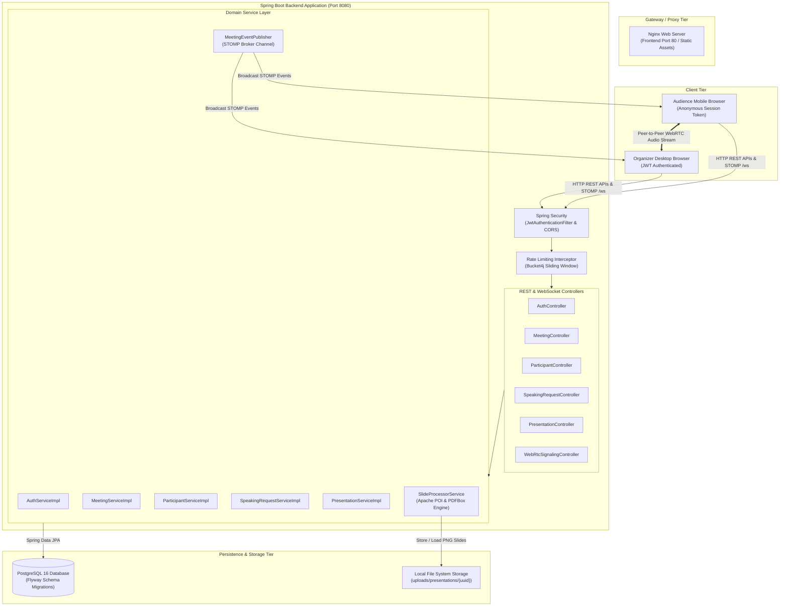
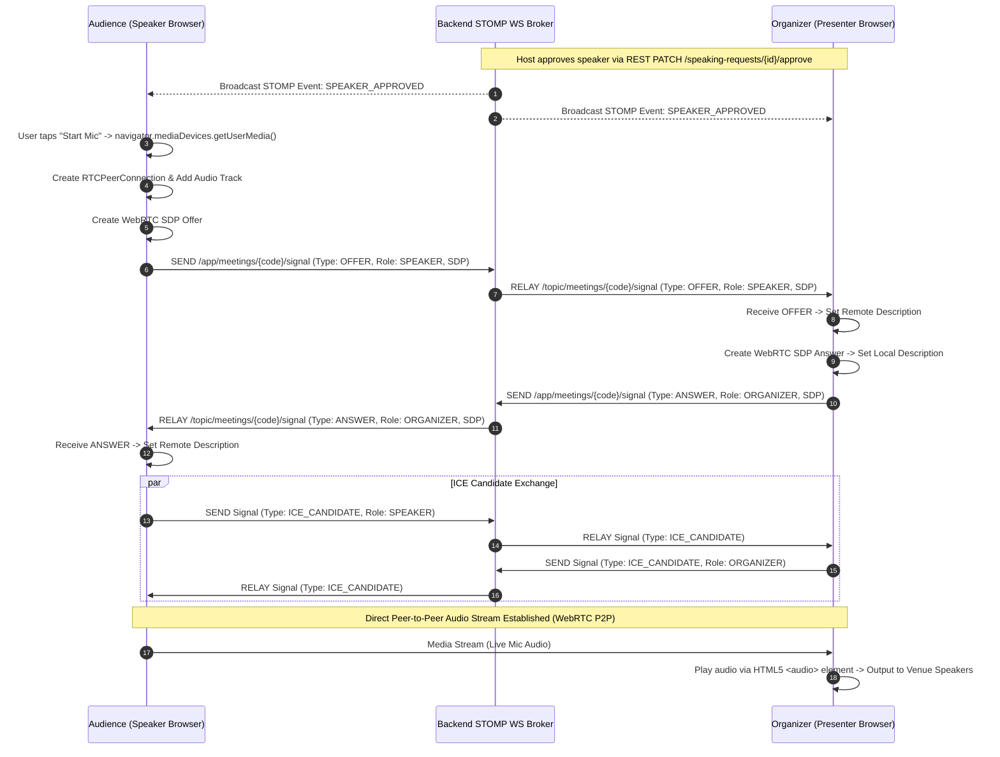
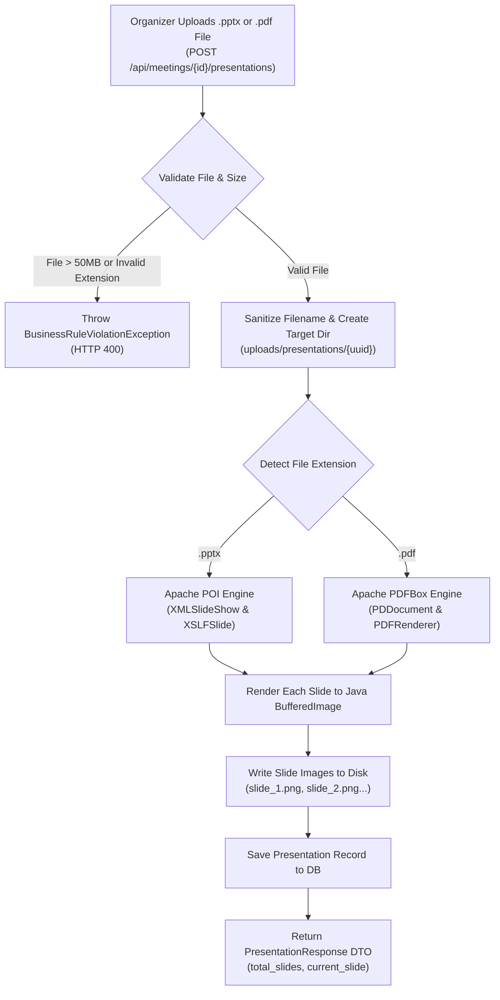
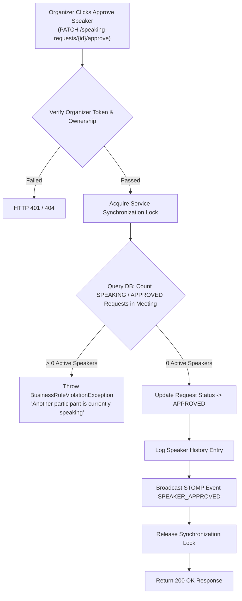

# VoiceBridge — System Architecture & Design Specification

---

## 1. HIGH-LEVEL SYSTEM ARCHITECTURE

---

## 2. REAL-TIME WEBRTC SIGNALING & AUDIO FLOW

---

## 3. DATABASE RELATIONSHIP DIAGRAM (ERD)

```mermaid
erDiagram
    ORGANIZERS ||--o{ MEETINGS : "creates"
    MEETINGS ||--o{ PARTICIPANTS : "contains"
    MEETINGS ||--o{ SPEAKING_REQUESTS : "manages"
    MEETINGS ||--o{ PRESENTATIONS : "hosts"
    MEETINGS ||--o| PRESENTATION_SESSIONS : "active_session"
    MEETINGS ||--o{ SPEAKER_HISTORY : "audits"
    PARTICIPANTS ||--o{ SPEAKING_REQUESTS : "raises"
    PARTICIPANTS ||--o{ SPEAKER_HISTORY : "records"
    PRESENTATIONS ||--o| PRESENTATION_SESSIONS : "currently_presenting"

    ORGANIZERS {
        bigint id PK
        varchar email UK
        varchar name
        varchar password_hash
        timestamp created_at
    }

    MEETINGS {
        bigint id PK
        varchar meeting_code UK
        varchar qr_token UK
        bigint organizer_id FK
        varchar status
        timestamp created_at
    }

    PARTICIPANTS {
        bigint id PK
        bigint meeting_id FK
        varchar name
        varchar session_token UK
        varchar status
        boolean active
    }

    SPEAKING_REQUESTS {
        bigint id PK
        bigint meeting_id FK
        bigint participant_id FK
        varchar status
        integer queue_position
        timestamp requested_at
    }

    SPEAKER_HISTORY {
        bigint id PK
        bigint meeting_id FK
        bigint participant_id FK
        bigint duration_seconds
        varchar end_reason
    }

    PRESENTATIONS {
        bigint id PK
        bigint meeting_id FK
        varchar file_name
        varchar storage_path
        integer total_slides
        integer current_slide
    }

    PRESENTATION_SESSIONS {
        bigint id PK
        bigint meeting_id FK, UK
        bigint presentation_id FK
        integer current_slide
        boolean is_presenting
    }
```

---

## 4. PRESENTATION PROCESSING & SLIDE CONVERSION WORKFLOW

---

## 5. SINGLE-ACTIVE-SPEAKER INVARIANT & CONCURRENCY CONTROL

---

## 6. END-TO-END DATA FLOW SUMMARY

1. **Host Setup:** Host authenticates with JWT (`/api/auth/login`) → Creates meeting (`/api/meetings`) → Uploads slides (`/api/meetings/{id}/presentations`) → Apache POI/PDFBox renders slides to PNGs.
2. **Audience Join:** Attendee scans QR code → Joins meeting (`/api/participants/join/{code}`) → Receives UUID `sessionToken` → Subscribes to STOMP WebSocket topic `/topic/meetings/{code}`.
3. **Queue Moderation:** Attendee raises hand → `SpeakingRequest` saved with FIFO `queue_position` → Host approves request → Synchronized lock verifies single-speaker invariant.
4. **P2P Audio & Subtitles:** Approved attendee browser sends WebRTC Offer over WebSocket → Host browser returns WebRTC Answer → P2P WebRTC audio stream connects → Host browser plays audio and passes stream to `Web Speech API` for live slide caption overlay.

### Slide intelligence

After the presentation is rendered, `SlideAnalysisService` extracts one structured record per
slide from PPTX shapes or PDF text. Each record includes editable title and concepts,
extracted text, notes, code/table flags, and `structure_json`. The record starts in `QUEUED`
state and `SlideEnrichmentService` creates an `SLIDE_ENRICH` entry in `ai_jobs`, calls the
local AI service at `/v1/slides/enrich`, and publishes `SLIDE_ANALYSIS_UPDATED` on the
meeting topic. If the optional embedding model is unavailable, deterministic local analysis
is retained and the slide remains usable.

Organizers can review and correct the active slide through `SlideInspector`; updates use
`PUT /api/presentations/{presentationId}/analysis/{slideId}`. Analysis data is never exposed
through the audience presentation endpoints.
5. **Closure:** Host closes session → Status transitions to `CLOSED` → WebSocket notifies all audience clients → Audience browsers redirect to `/closed/:code`.
